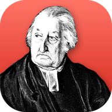

<div align="center">
  <a href="https://getnodalia.com">
    
  </a>
  <br><br>
  
  <h1>Buzón</h1>
  <p><strong>The email client of the Nodalia suite.</strong></p>

  <p>
    
    
    
    
    <a href="./COPYING"></a>
  </p>

  <p>
    <a href="#overview">Overview</a> ·
    <a href="#what-it-does">What it does</a> ·
    <a href="#privacy">Privacy</a> ·
    <a href="#build-and-run">Build</a> ·
    <a href="#project-status">Status</a> ·
    <a href="#the-nodalia-suite">Suite</a> ·
    <a href="#license">License</a>
  </p>
</div>

---

## Overview

**Buzón** is the email client of [Nodalia](https://getnodalia.com): a native app written in Rust,
drawn in GTK4 with the Nodalia Design Language. It keeps all your accounts in one window, syncs in
the background and sends no telemetry.

> [!IMPORTANT]
> **Buzón is at an early stage.** There are no packages yet; build it from source (below).
> Installable releases follow with the Nodalia interface.

## What it does

- Several accounts at once over IMAP, POP3 or JMAP, with one combined inbox. Google and Microsoft
  accounts sign in through your desktop's online accounts or with OAuth.
- The whole mailbox is synced and searchable. Mail you move, delete or flag on your phone is
  updated here too.
- Write in rich text, Markdown, HTML or plain text. A message that cannot go out waits in the
  Outbox, and any message can be scheduled for later.
- OpenPGP with the GnuPG already on your computer: read, sign and encrypt mail, and manage keys.
- Filters, tags and conversations, with optional single-key shortcuts.
- The Nodalia interface: rounded islands, Buzón's red accent, round window controls (or your
  desktop's own, on Linux), its menu in the top bar, light and dark following the system.

## Privacy

Remote content is blocked until you allow it, so tracking pixels cannot report that you opened a
message. Passwords and tokens live in the system keyring, never in files, and decrypted mail is
never written to the cache. Buzón makes no requests to analytics or AI services.

## Build and run

You need a recent stable Rust toolchain, a C compiler, and the GTK 4, WebKitGTK 6, Poppler,
OpenSSL, gettext and Wayland development packages. At runtime Buzón needs a Secret Service
provider such as gnome-keyring.

```bash
# Fedora
sudo dnf install gcc gcc-c++ gtk4-devel libadwaita-devel webkitgtk6.0-devel poppler-glib-devel \
    openssl-devel gettext-devel wayland-devel
# Debian / Ubuntu
sudo apt install build-essential pkg-config libgtk-4-dev libadwaita-1-dev libwebkitgtk-6.0-dev \
    libpoppler-glib-dev libssl-dev gettext libwayland-dev
```

Then:

```bash
git clone https://github.com/getnodalia/buzon.git
cd buzon
cargo run --release
```

## Project status

| Area | State |
|---|---|
| Mail engine (IMAP, POP3, JMAP, SMTP, sync, search) | Working |
| App icon | Done |
| Buzón names, app ID and settings folder | Done |
| Nodalia interface: theme, islands, window controls, main menu | Planned |
| Global menu in the top bar (D-Bus) | Planned |
| Installable packages (Flatpak, AppImage, .deb, .rpm, DMG) | Planned |

## App icon

Nodalia app icons are black-and-white portraits of historical figures over the app colour.
Provenance and sizes are in [`data/icons/`](data/icons/).

## The Nodalia suite

Buzón is one of the applications of [Nodalia](https://getnodalia.com), an independent software
project developed in public by [Daniel Miguel Tejedor](https://danielmigueltejedor.com).

## License

Buzón is free software under the [GNU Affero General Public License v3.0 or later](COPYING).
Copyright notices for code by other authors are kept in the source and listed in [`NOTICE`](NOTICE).
